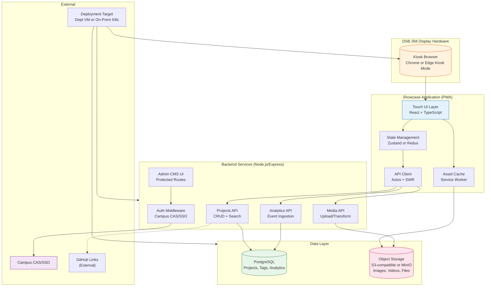
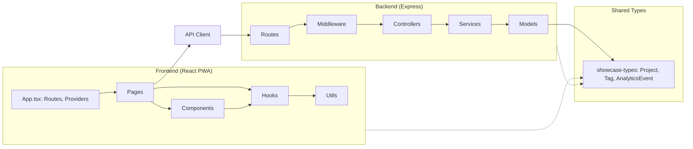
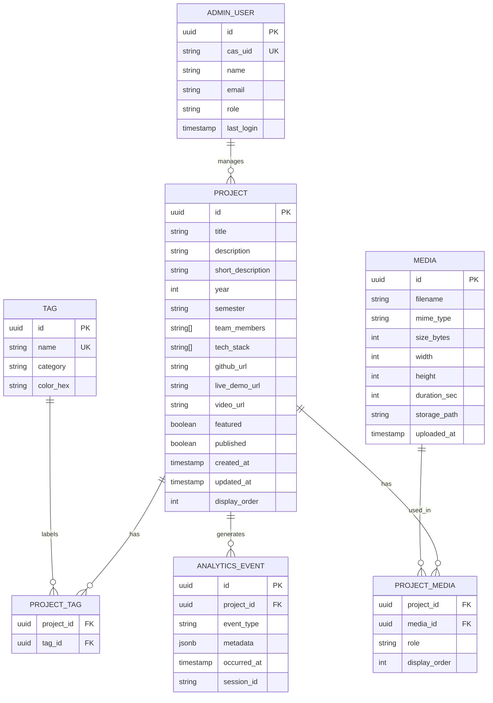
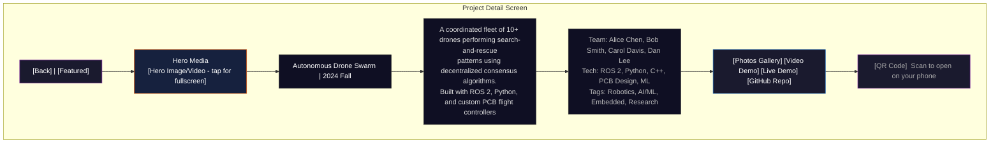

# Design Materials — Senior Design Showcase Display

## Product Overview

**What is it?**  
A full-screen, touch-enabled web application running in kiosk mode on the large display outside DSB 268. It replaces the current timed slideshow with an interactive exploration interface for senior design projects.

**Who uses it?**
- **Prospective students** (primary) — High school students and families on campus tours. They want to see "what do CSE students actually build?" in an engaging, self-guided way.
- **Current students** — Looking for capstone inspiration, checking what past teams did in their interest area.
- **Faculty & staff** — Using the display as a talking point during tours and open houses.
- **Visitors & alumni** — Casual browsing, nostalgia, seeing department evolution.

**What problem does it solve?**  
The current slideshow is passive, static, and shows generic department info. It doesn't showcase the *outcomes* of the program — the actual projects students build. This application turns the display into a living portfolio that:
- Lets visitors discover projects by category, year, or keyword
- Shows rich media (images, videos, live demo links)
- Requires zero training — walk up, touch, explore
- Runs unattended for months with automatic recovery

**Success looks like:** A prospective student spends 3+ minutes exploring projects on the display during a tour, leaves with a concrete sense of what CSE capstones achieve, and the department staff can update the project catalog without IT help.

---

## Key Features & Capabilities

| # | Feature | Priority | Charter Link | Description |
|---|---------|----------|--------------|-------------|
| F1 | **Project Grid Browser** | Must-have | Scope: Interactive showcase | Touch-scrollable grid of project cards (thumbnail, title, year, tags). Infinite scroll or pagination. |
| F2 | **Project Detail View** | Must-have | Scope: Visual + interactive material | Full-screen detail: description, team, tech stack, images, video, live demo link, GitHub link. |
| F3 | **Touch Navigation** | Must-have | Scope: Touch-screen display | Tap to select, swipe to navigate, pinch-to-zoom images, back gesture. Large touch targets (≥48px). |
| F4 | **Search & Filter** | Must-have | Scope: Find relevant projects | Text search (title, description, team), filter by year, category/tags, tech stack. |
| F5 | **Attract Mode / Idle Loop** | Must-have | Scope: Unattended kiosk | After 60s idle: auto-play highlight reel of projects. Touch any screen to exit to browser. |
| F6 | **Admin CMS** | Must-have | Scope: Client-manageable content | Web-based admin: add/edit/archive projects, upload media, manage tags, reorder featured. Auth via campus SSO. |
| F7 | **Video Playback** | Should-have | Scope: Visual material | Inline video player for project demo videos. Auto-play muted in attract mode; full-screen on tap. |
| F8 | **Interactive Demo Embed** | Should-have | Scope: Interactive material | Iframe/WebView embed for playable web projects (games, tools, visualizations). Sandbox permissions. |
| F9 | **Usage Analytics** | Should-have | Scope: Department insights | Anonymous events: project views, detail opens, video plays, search queries. Dashboard in CMS. |
| F10 | **Kiosk Hardening** | Must-have | Scope: Unattended reliability | Auto-restart on crash, memory watchdog, screen burn-in prevention (subtle motion), disable OS UI. |
| F11 | **Accessibility (WCAG AA)** | Should-have | Scope: Inclusive access | High contrast mode toggle, large text option, screen reader labels (for staff), keyboard fallback. |
| F12 | **Multi-language** | Could-have | — | English default; Spanish/Chinese toggle for tour groups. |
| F13 | **QR Code Deep Links** | Could-have | — | QR on detail view → open project on visitor's phone. |
| F14 | **AI Project Recommender** | Could-have | — | "Similar projects" sidebar based on tags/description embeddings. |

---

## High-Level Structure: System Architecture



### Architecture Notes

- **Single-Page Application (PWA)** — Runs offline-capable via Service Worker. Caches all project data and assets for instant navigation and resilience.
- **Kiosk Mode** — Chrome/Edge launched with `--kiosk --noerrdialogs --disable-infobars`. Auto-restart via systemd/service wrapper.
- **Backend** — Lightweight Node.js/Express API. Could be deployed as serverless functions if department prefers.
- **Database** — PostgreSQL for structured data (projects, tags, analytics events). Simple schema, low write volume.
- **Object Storage** — MinIO (on-prem S3-compatible) for images/videos. Avoids DB bloat, enables CDN later.
- **Authentication** — Campus CAS/SSO for admin CMS only. Public kiosk requires no login.
- **Deployment** — Department VM or on-prem Kubernetes. CI/CD via GitLab CI → Docker → target.

---

## Design Artifacts

### 1. Application Architecture (Component Diagram)



**Key Components:**
- **`useProjects` hook** — SWR-powered data fetching with cache, deduping, optimistic updates
- **`useKiosk` hook** — Manages idle timer, attract mode, wake lock, fullscreen
- **`ProjectCard` / `ProjectDetail`** — Primary display components, touch-optimized
- **`AttractLoop`** — Ken Burns-style pan/zoom on featured projects during idle
- **`MediaPlayer`** — Wrapper for `<video>` with custom touch controls, PiP support
- **`DemoIframe`** — Sandboxed iframe for interactive projects, CSP headers

---

### 2. Data Model / Entity Relationship Diagram



**Notes:**
- `PROJECT.tech_stack` stored as JSON array for flexible querying
- `ANALYTICS_EVENT.event_type`: `view`, `detail_open`, `video_play`, `search`, `filter`, `idle_wake`
- `MEDIA.role`: `thumbnail`, `gallery`, `video`, `demo_embed`
- Soft deletes via `published` flag; admin can archive without losing data

---

### 3. Wireframes / Key Screen Mockups

#### A. Attract Mode (Idle Screen)

```mermaid
flowchart TB
    subgraph Screen["Display Screen"]
        Hero["Hero Area\n[Ken Burns pan/zoom on project image]"]
        Info["Project Info Card\n\"Autonomous Drone Swarm\" - 2024 Fall\nAI/ML, Robotics, Computer Vision\n[Touch anywhere to explore]"]
        Nav["[Auto-advances every 15s]"]
    end

    Hero --> Info
    Info --> Nav
    Nav --> Hero

    style Hero fill:#1a1a2e,stroke:#e65100,stroke-width:2,color:#fff
    style Info fill:#16213e,stroke:#1565c0,stroke-width:2,color:#fff
    style Nav fill:#0f0f23,stroke:#7b1fa2,stroke-width:1,color:#aaa
```

#### B. Project Grid (Main Browser)

```mermaid
flowchart TB
    subgraph Grid["Project Grid Screen"]
        Header["Senior Design Showcase | Search"]
        Filters["Filter: All | Year: All | Category: All | Tech: All | Sort: Newest | Reset"]
        
        subgraph Row1["Row 1"]
            Card1["[IMG] Drone Swarm\n2024 Fall | AI/ML"]
            Card2["[IMG] StudyBuddy\n2024 Fall | Web, Ed"]
            Card3["[IMG] CodeViz\n2023 Spring | DevTools"]
            Card4["[IMG] EcoTrack\n2023 Fall | IoT, Env"]
        end
        
        subgraph Row2["Row 2"]
            Card5["[IMG] MedScan\n2023 Spring | Health"]
            Card6["[IMG] GameForge\n2022 Fall | Games"]
            Card7["[IMG] SecureChat\n2022 Spring | Security"]
            Card8["[IMG] RoboArm\n2022 Fall | Robotics"]
        end
        
        Hint["[Swipe or drag to scroll - Tap card for details]"]
    end

    Header --> Filters
    Filters --> Row1
    Row1 --> Row2
    Row2 --> Hint

    style Header fill:#1a1a2e,stroke:#e65100,color:#fff
    style Filters fill:#16213e,stroke:#1565c0,color:#fff
    style Row1 fill:#0f0f23,stroke:#333
    style Row2 fill:#0f0f23,stroke:#333
    style Hint fill:#1a1a2e,stroke:#7b1fa2,color:#aaa
```



#### C. Project Detail View



#### D. Admin CMS - Project List

```mermaid
flowchart TB
    subgraph Admin["Admin Dashboard"]
        Header["Admin Dashboard | [+ Add Project]"]
        Search["Search projects... | [Filters]"]
        
        subgraph Table["Project Table"]
            Head["[ ] | Title | Year | Status | Ord | Actions"]
            Row1["[ ] | Drone Swarm | 2024F | Published | 1 | [Edit] [Delete]"]
            Row2["[ ] | StudyBuddy | 2024F | Published | 2 | [Edit] [Delete]"]
            Row3["[ ] | CodeViz | 2023S | Published | 3 | [Edit] [Delete]"]
            Row4["[ ] | Old Project | 2020F | Archived | - | [Edit] [Delete]"]
        end
        
        Bulk["[Drag to reorder] [Bulk: Feature Delete Archive]"]
    end

    Header --> Search
    Search --> Table
    Table --> Bulk

    style Header fill:#1a1a2e,stroke:#e65100,color:#fff
    style Search fill:#16213e,stroke:#1565c0,color:#fff
    style Table fill:#0f0f23,stroke:#333
    style Bulk fill:#1a1a2e,stroke:#7b1fa2,color:#aaa
```



---

## Design Decisions & Open Questions

### Significant Design Decisions

| # | Decision | Rationale | Alternatives Considered |
|---|----------|-----------|------------------------|
| D1 | **PWA (React + Vite) over Electron** | Runs in browser kiosk mode; no native build pipeline; easier deployment to department VM; Service Worker gives offline caching for free. | Electron: heavier, requires code signing, auto-update complexity. Native app: platform-specific, harder to maintain. |
| D2 | **Chrome/Edge Kiosk Mode over full-screen app** | Zero-config on managed department machines; IT can push via Group Policy; standard browser engine; security updates automatic. | Custom kiosk OS (e.g., Ubuntu Kiosk): requires imaging, IT involvement. Electron kiosk: same maintenance as PWA but heavier. |
| D3 | **PostgreSQL + MinIO over single DB blob storage** | Separates structured query needs (search, filter, analytics) from large binary assets. MinIO is S3-compatible, supports presigned URLs, easy to swap for cloud later. | MongoDB: less familiar to team, overkill for relational project data. PostgreSQL BYTEA: bloats DB, slow backups, no CDN integration. |
| D4 | **Campus CAS/SSO only for Admin CMS** | No passwords to manage; department staff already have credentials; aligns with university policy. Public kiosk needs zero auth. | Custom auth (email/password): credential management burden. OAuth (Google/GitHub): not university identities. |
| D5 | **Attract Mode as Ken Burns pan/zoom** | Visually engaging without video playback complexity; works with static images; subtle motion prevents screen burn-in; accessible (respects `prefers-reduced-motion`). | Auto-playing video reel: bandwidth, licensing, accessibility issues. Static carousel: looks like current slideshow. Carousel with auto-advance: less dynamic. |

### Open Questions (with Resolution Target)

| # | Question | Target Resolution | Owner |
|---|----------|-------------------|-------|
| Q1 | **What is the exact hardware spec of the DSB 268 display?** (Resolution, touch points, OS, browser version) | **Phase 1 (Week 2)** — Visit site, document specs, test browser kiosk mode | Team Lead |
| Q2 | **Can department IT provide a dedicated VM/container for hosting?** (Specs, network access, SSL certs, domain) | **Phase 1 (Week 3)** — Request via department IT ticket | Team Lead |
| Q3 | **What is the format/volume of existing senior project archive data?** (Spreadsheets, PDFs, images, videos — how many years, how many projects?) | **Phase 1 (Week 2)** — Meet with department admin/archivist | Content Lead |
| Q4 | **Are there any interactive projects that need special embedding?** (Unity WebGL, WebAssembly, custom servers, hardware demos) | **Phase 2 (Week 6)** — Inventory during data import | Dev Lead |
| Q5 | **Does the client want analytics exposed to students/faculty, or only admins?** (Public dashboard vs. admin-only) | **Phase 2 (Week 7)** — Confirm with client at Sprint 2 review | Team Lead |
| Q6 | **What is the department's policy on external links from the kiosk?** (GitHub, live demos — allowed? sandboxed? blocked?) | **Phase 2 (Week 5)** — Security review with IT | Dev Lead |
| Q7 | **Screen burn-in mitigation: is subtle motion sufficient, or does IT require pixel-shifting?** | **Phase 3 (Week 11)** — Test 48-hr run on actual hardware | Dev Lead |

---

## Related Pages

- [📋 Project Roadmap](Roadmap.md) — Phases, timeline, and milestones
- [📝 Requirements](Requirements.md) — Detailed user stories and acceptance criteria
- [🏠 Wiki Home](Home.md) — Project overview and quick links

---

*Design version 1.0 — Created November 2026. Decisions and open questions will be updated as the project progresses.*