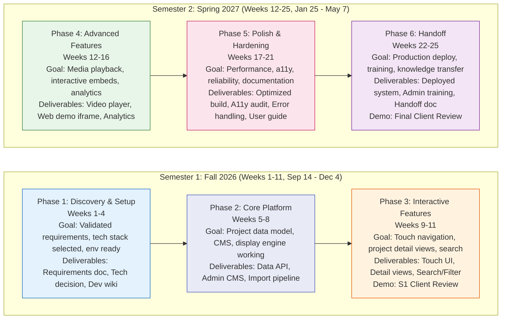

# Project Roadmap — Senior Design Showcase Display

## Chevron Diagram: Two-Semester Phase Overview



---

## Gantt Chart: Workstreams by Week

```mermaid
gantt
    title Senior Design Showcase Display - 25 Week Timeline
    dateFormat  YYYY-MM-DD
    axisFormat  %W
    todayMarker stroke-width:2,stroke:red

    %% Semester 1: Weeks 1-11 (Sep 14 - Dec 4, 2026)
    %% Semester 2: Weeks 12-25 (Jan 25 - May 7, 2027)

    section Semester 1 - Frontend UI
    Touch UI Framework Research       :active, fe1, 2026-09-14, 2w
    Project Grid and Card Components  :fe2, after fe1, 2w
    Touch Navigation and Gestures     :fe3, after fe2, 2w
    Project Detail View               :fe4, after fe3, 2w
    Search and Filter UI              :fe5, after fe4, 2w

    section Semester 1 - Backend CMS
    Tech Stack Decision               :be1, 2026-09-14, 1w
    Data Model and API Design         :be2, after be1, 2w
    Project CRUD API                  :be3, after be2, 2w
    Admin CMS (Auth, Projects)        :be4, after be3, 3w
    Media Upload and Processing       :be5, after be4, 2w

    section Semester 1 - Content Pipeline
    Sample Data Creation              :cp1, 2026-09-28, 2w
    Dept Archive Data Import          :cp2, after cp1, 3w
    Media Standardization             :cp3, after cp2, 2w
    Automated Import Pipeline         :cp4, after cp3, 2w

    section Semester 1 - Infrastructure DevOps
    Dev Environment Setup             :in1, 2026-09-14, 1w
    CI/CD Pipeline                    :in2, after in1, 2w
    Kiosk Mode Prototype              :in3, 2026-11-02, 2w
    Staging Deployment                :in4, 2026-12-04, 1w

    section Semester 1 - Testing QA
    Unit and Integration Tests        :tq1, 2026-10-12, 4w
    Touch Device Testing              :tq2, 2026-12-04, 2w

    section Semester 2 - Frontend UI
    Video and Interactive Player UI   :fe6, 2027-01-25, 2w
    Polish Animations and Transitions :fe7, 2027-03-08, 2w
    Accessibility Audit and Fixes     :fe8, 2027-03-22, 2w

    section Semester 2 - Backend CMS
    Analytics API                     :be6, 2027-01-25, 2w
    Performance Optimization          :be7, 2027-03-22, 2w

    section Semester 2 - Content Pipeline
    Content QA and Verification       :cp5, 2027-02-08, 2w

    section Semester 2 - Infrastructure DevOps
    Production Deploy Prep            :in5, 2027-04-05, 2w
    Production Deployment             :in6, 2027-05-07, 1w

    section Semester 2 - Testing QA
    Cross-Browser Testing             :tq3, 2027-03-08, 2w
    Load and Stress Testing           :tq4, 2027-04-05, 2w
    UAT with Client                   :tq5, 2027-05-07, 1w

    %% Milestones (inline syntax)
    M1 S1 Demo Week 11                :milestone, m1, 2026-12-04, 1d
    M2 S2 Midpoint Review             :milestone, m2, 2027-03-08, 1d
    M3 Final Demo Week 25             :milestone, m3, 2027-05-07, 1d

    %% Dependencies
    fe2 --> be3
    fe3 --> fe2
    fe4 --> be3
    fe5 --> be3
    fe6 --> be5
    be4 --> be3
    be5 --> be4
    cp2 --> be3
    cp4 --> be5
    in3 --> fe3
    in4 --> fe4
    in5 --> fe7
    tq1 --> be3
    tq2 --> in3
    tq3 --> fe7
    tq4 --> be7
```

---

## Supporting Narrative (1–2 Pages)

### Sequencing Rationale

**Why this order?** The roadmap is sequenced to front-load risk reduction and establish a "walking skeleton" by the end of Semester 1.

1. **Discovery & Setup first (Phase 1)** — We validate requirements with the client, select the tech stack (critical for touch/kiosk constraints), and establish the development environment before investing in features. The touch-screen kiosk mode is a unique constraint that drives technology choices (e.g., Electron vs. PWA, browser kiosk mode vs. full-screen app).

2. **Core Platform before Interactive Features (Phases 2→3)** — The data model, CMS, and display engine must exist before we can build meaningful touch interactions. Building the UI against a real API (even a local mock) prevents rework. The Semester 1 demo (Week 11) shows a working kiosk with real project data — this is the minimum viable product that proves the concept.

3. **Interactive Features before Advanced Features (Phases 3→4)** — Core browsing, search, and detail views are must-haves. Video playback, interactive demo embedding (iframes/WebViews for playable projects), and analytics are enhancements that depend on the core navigation working reliably.

4. **Polish & Hardening before Handoff (Phases 5→6)** — Two weeks of dedicated hardening ensures the kiosk runs unattended for months: memory leaks, crash recovery, auto-restart, screen burn-in prevention, and accessibility compliance. The handoff phase includes client training on the CMS so they can update projects independently.

**Semester Boundary (Week 11/12):** Semester 1 ends with a **client-accepted demo** on the actual display hardware (or close simulation). Semester 2 begins with that working foundation — no "big bang" integration at the end.

### Top Risks to Schedule (3–5)

| Risk | Likelihood | Impact | Mitigation |
|------|------------|--------|------------|
| **Physical display access delayed** | High | High | Develop on 27" touch monitor in lab; test on target hardware in Phase 3 (Week 10). Have kiosk-mode browser fallback. |
| **Dept archive data unavailable/incomplete** | Medium | High | Start with curated sample data (5–10 projects) in Phase 1. Parallel track: work with department admin to export/clean real data. |
| **Touch UX complexity underestimated** | Medium | Medium | Prototype core gestures (tap, swipe, pinch) in Phase 1 spike. Use established library (e.g., Hammer.js, Pointer Events). |
| **Kiosk mode reliability (crashes, updates, sleep)** | Medium | High | Build watchdog/restart mechanism in Phase 2. Test 48-hr continuous run in Phase 5. Disable OS updates/sleep via group policy. |
| **Client scope creep on "interactive demos"** | Medium | Medium | Define "interactive" clearly in Phase 1: iframe embeds for web projects, video for others. Native app execution is out of scope. |

### Assumptions

1. **Team capacity:** 3–4 students × 8–10 hrs/week each during semester.
2. **Client responsiveness:** Requirements clarification within 1 week; CMS training scheduled by Week 22.
3. **Hardware access:** Lab touch monitor available from Week 1; DSB 268 display accessible for testing by Week 10.
4. **Department IT support:** Kiosk mode browser configuration (Chrome/Edge kiosk) supported; no custom OS image required.
5. **Data format:** Senior project metadata available as spreadsheet/CSV; media assets (images, videos) provided by students or captured from existing presentations.
6. **No IRB/ethics review needed** — this is a display tool, not human subjects research.

### What's Not on the Roadmap (Deferred / Stretch Goals)

- **Native mobile companion app** — QR code link to project details on phone (could-have)
- **Multi-language support** — English only for MVP
- **Real-time collaboration / social features** — comments, favorites, sharing
- **AI-powered project recommendations** — "Students who liked X also liked Y"
- **Live data feeds** — GitHub stars, deployment status (requires student opt-in)
- **Accessibility beyond WCAG AA** — screen reader optimization for kiosk context is limited
- **Cloud-hosted version** — Department hosting on-prem/VM is the target

---

## Release / Demo Points

| Demo | Target Week | Audience | What's Shown |
|------|-------------|----------|--------------|
| **Internal Sprint 1** | Week 4 | Team/Instructor | Tech stack decision, dev env, sample data |
| **Internal Sprint 2** | Week 8 | Team/Instructor | CMS working, API returning project data |
| **Semester 1 Client Review** | **Week 11** | **Client + Instructor** | **Full kiosk: browse projects, view details, search, touch navigation on hardware** |
| **Semester 2 Midpoint** | Week 18 | Instructor | Video playback, interactive embeds, analytics dashboard |
| **Final Client Review** | **Week 25** | **Client + Instructor + Dept** | **Production deployment on DSB 268 display, CMS training, handoff docs** |

---

*Roadmap version 1.0 — Created November 2026. Expect changes; this is a living document.*